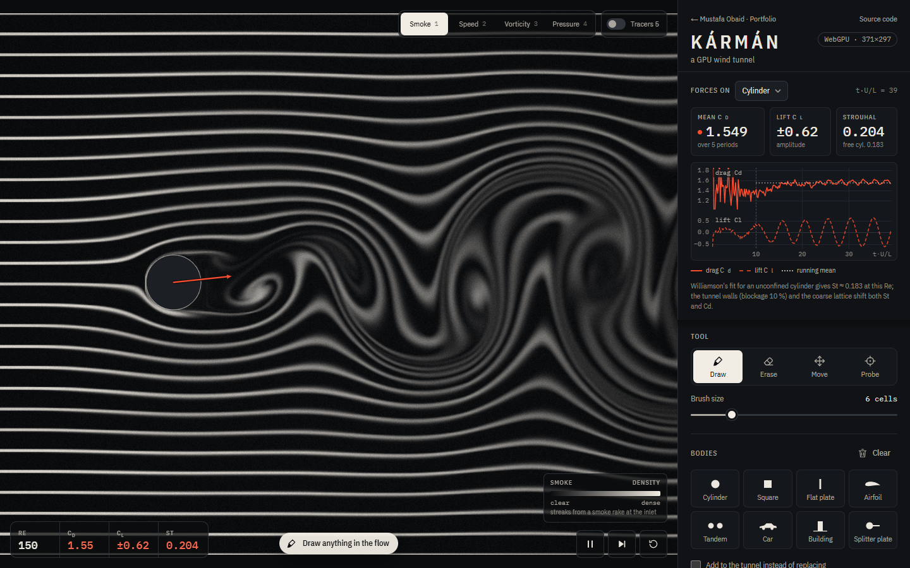

# Kármán — a GPU wind tunnel

Draw any shape into a live lattice-Boltzmann wind tunnel and measure the drag, lift and vortex
shedding it causes — on the GPU with WebGPU, with a CPU fallback.

**Live demo: <https://mustafaobaidd1.github.io/karman-wind-tunnel/>**



## The question

How does an object's shape change the air flowing around it, and the force it feels? Kármán
answers it the way a wind-tunnel lab does: put a body in a steady stream, watch the smoke, and
read the drag and lift off the balance. Draw a doodle, drop in an airfoil or a car, change the
speed or the viscosity, and the wake and the numbers respond immediately.

## Features

- **Live tunnel.** Opens on a circular cylinder at Re = 150 shedding a Kármán vortex street,
  rendered as white smoke streaks from an inlet rake on near-black, with film grain.
- **Draw and erase** obstacles with a brush (adjustable size). Every stroke becomes a vector
  body; erasing cuts holes that move with the body.
- **Presets that stay editable:** cylinder, square, flat plate, NACA 4-digit airfoil (camber,
  camber position, thickness, chord, angle of attack), tandem cylinders, a car silhouette, a
  surface-mounted building block, and a cylinder with a splitter plate. Select, drag, rotate
  (handle or <kbd>[</kbd> <kbd>]</kbd>), nudge with arrow keys, delete.
- **Controls:** inlet speed (with a Mach warning above 0.1 lattice units), viscosity (log
  slider), the resulting Reynolds number for the measured body with an everyday equivalent
  ("a 2 mm rod in air at 1.1 m/s … would shed vortices about 115 times per second"),
  play / pause / step / reset, and lattice resolution (auto-picked from a GPU throughput test,
  with a manual override).
- **Views:** smoke, speed magnitude (perceptual sequential map), vorticity (diverging, dark
  centre), pressure coefficient (diverging), plus tracer particles — each with a legend.
- **Measurements, per body:** drag and lift coefficients by momentum exchange, a live
  drag/lift chart against convective time, the running mean drag over whole shedding periods,
  the lift amplitude, the Strouhal number from the lift's zero crossings (compared with
  Williamson's free-cylinder fit for cylinders), and a hover/tap probe for local velocity and
  pressure coefficient. Red force arrows on every body.
- **Benchmark mode:** one click sets up the Schäfer & Turek (1996) DFG channel — H = 0.41,
  D = 0.1 at (0.2, 0.2), parabolic inflow, no-slip walls — for case 2D-1 (Re 20, steady) or 2D-2
  (Re 100, periodic), at 10/20/40 cells per diameter, with interpolated or half-way
  bounce-back, runs it at full speed and shows measured versus reference values.
- **How it works** panel with the model, equations (KaTeX), units, the recorded validation table
  and limitations.
- **States designed:** initialisation progress, CPU-fallback banner, instability recovery with a
  suggested lower speed, empty tunnel, pause when the tab is hidden, reduced motion.

## How it works

**Model.** Two-dimensional, weakly compressible flow solved with the **D2Q9 lattice Boltzmann
method**: nine particle populations per node stream to their neighbours and collide towards a
local equilibrium,

$$f_i(\mathbf{x}+\mathbf{c}_i, t+1) = f_i^{*}(\mathbf{x}, t),\qquad f_i^{\mathrm{eq}} = w_i\rho\left(1+3\,\mathbf{c}_i\!\cdot\!\mathbf{u}+\tfrac92(\mathbf{c}_i\!\cdot\!\mathbf{u})^2-\tfrac32u^2\right).$$

**Collision: two relaxation times (TRT)** with the magic parameter Λ = 3/16 (Ginzburg et al.
2008). The symmetric part relaxes with ω⁺, which sets the viscosity
ν = c_s²(1/ω⁺ − ½) with c_s² = 1/3; the antisymmetric part relaxes with ω⁻ chosen so that
(1/ω⁺ − ½)(1/ω⁻ − ½) = 3/16. Populations are stored as deviations from rest, g = f − w, in
float32.

**Numerics.** One fused "pull" kernel per time step (stream + collide + boundaries), ping-pong
buffers in structure-of-arrays layout. Per-node forces are reduced per body (up to 16 bodies) in
shared memory every step into a ring buffer that is read back with `mapAsync` only every few
frames. Steps per frame adapt to keep the page at frame rate.

**Boundaries.**

| Where       | Condition                                                                                                                                                                                                                |
| ----------- | ------------------------------------------------------------------------------------------------------------------------------------------------------------------------------------------------------------------------ |
| Inlet       | Zou–He velocity condition (uniform, or parabolic in benchmark mode), optional smooth ramp                                                                                                                                |
| Outlet      | Non-equilibrium extrapolation at ρ = 1 (Guo, Zheng & Shi 2002)                                                                                                                                                           |
| Top/bottom  | Free-slip (specular) in the open tunnel, half-way bounce-back no-slip in benchmark mode                                                                                                                                  |
| Bodies      | Bounce-back on every link that crosses the surface, **linearly interpolated with the exact wall distance q** from the vector shape (Bouzidi, Firdaouss & Lallemand 2001); half-way where no interpolation partner exists |
| Open tunnel | Absorbing layers next to the inlet (relax to the free stream) and outlet (relax density to 1)                                                                                                                            |
| Benchmark   | A viscous sponge over the last 0.2 m before the outlet; inlet ramped over 1 s from rest                                                                                                                                  |

**Forces** come from momentum exchange (Ladd 1994) on every boundary link,
F = Σ c_i (f_i\* + f̃_ī), normalised as C_d = 2F_x/(ρU²L), C_l = 2F_y/(ρU²L). For the benchmark
L = D and U is the mean inflow speed Ū = ⅔U_max, exactly as in Schäfer & Turek. The Strouhal
number St = fL/U uses the lift's upward zero crossings (hysteresis band, linear interpolation).

**Units: only Re matters.** Lattice lengths are cells and time is steps; the inlet speed is a
lattice velocity (≤ 0.1 recommended, Ma = √3 U). Re = UL/ν uses the selected body's
characteristic length (diameter, side, chord, frontal height). The app converts Re into an
everyday object of the same Reynolds number in air (ν = 1.51 × 10⁻⁵ m²/s) or water
(ν = 1.0 × 10⁻⁶ m²/s).

**Smoke** is a passive scalar on a grid twice as fine as the lattice, advected by a MacCormack
scheme along RK2 characteristics with the Selle et al. (2008) limiter, injected by an inlet rake
and slowly decaying. **Tracers** are RK2-advected particles.

**CPU fallback.** Without WebGPU, the same algorithm (the reference solver used by the tests)
runs in a Web Worker on Float32Array at about a tenth of the cells, and frames are painted with
Canvas 2D.

## Validation

**Kind of tool: an educational simulation with a quantitative benchmark mode.** The lattice
Boltzmann core is verified against analytic solutions and validated against a published
benchmark at the resolutions recorded below. The open tunnel itself (free-slip walls, blockage,
Mach 0.16, drawn shapes) is not a validated configuration.

**Unit tests** (Vitest; CPU reference solver; numbers measured with this code):

| Check                                                  | Reference                       | Result                                                      |
| ------------------------------------------------------ | ------------------------------- | ----------------------------------------------------------- |
| Equilibrium moments Σf, Σf c, Σf cc                    | exact (float64)                 | max error 6.7 × 10⁻¹⁶                                       |
| Mass, periodic box, 2000 steps                         | conserved                       | relative drift 1.3 × 10⁻¹⁵ (float64), 1.3 × 10⁻¹⁰ (float32) |
| Body-force Poiseuille flow, τ = 0.6/0.8/1.5            | parabola u = F y(H − y)/(2ρν)   | L2 error 2 × 10⁻¹⁴ … 5 × 10⁻¹⁶ (TRT, Λ = 3/16)              |
| Decaying Taylor–Green vortex, 64²                      | energy ∝ exp(−2ν\|k\|²t)        | decay-rate error −0.07 %                                    |
| Momentum-exchange drag vs. driving force, periodic box | equal at steady state           | 4.5 × 10⁻⁶ (half-way), 3.0 × 10⁻⁷ (interpolated)            |
| Zou–He inlet, free-slip walls                          | exact velocity / uniform stream | 10⁻¹²                                                       |
| WebGPU kernels vs. CPU reference (`e2e/gpu.spec.ts`)   | identical algorithm             | max \|Δu\| 3 × 10⁻⁷ after 400 steps, forces to 5 digits     |

**Schäfer & Turek (1996) DFG benchmark**, run with `npm run validate` on the CPU reference
solver (float64). D = cells per cylinder diameter, Ū = lattice mean inflow speed. Errors are
relative to the nearer end of the published range ("in range" = inside it).

_2D-1, Re = 20, steady_

| D   | Ū     | Cylinder walls | Grid    | c_D              | c_L                | ΔP              | L_a               |
| --- | ----- | -------------- | ------- | ---------------- | ------------------ | --------------- | ----------------- |
| 10  | 0.025 | interpolated   | 221×41  | 5.6473 (+1.0 %)  | 0.01156 (+5.1 %)   | 0.1140 (−2.7 %) | 0.0828 (−1.7 %)   |
| 20  | 0.025 | interpolated   | 441×82  | 5.6195 (+0.5 %)  | 0.01079 (in range) | 0.1150 (−1.9 %) | 0.0844 (in range) |
| 40  | 0.025 | interpolated   | 881×164 | 5.6094 (+0.35 %) | 0.01060 (in range) | 0.1168 (−0.3 %) | 0.0847 (in range) |
| 20  | 0.025 | half-way       | 441×82  | 5.7351 (+2.6 %)  | 0.01042 (in range) | 0.1151 (−1.8 %) | 0.0886 (+4.0 %)   |
| 40  | 0.025 | half-way       | 881×164 | 5.6391 (+0.9 %)  | 0.01036 (−0.4 %)   | 0.1159 (−1.1 %) | 0.0857 (+0.5 %)   |
| 20  | 0.05  | interpolated   | 441×82  | 5.7031 (+2.0 %)  | 0.01090 (in range) | 0.1168 (−0.3 %) | 0.0850 (in range) |
|     |       | **Reference**  |         | 5.57–5.59        | 0.0104–0.0110      | 0.1172–0.1176   | 0.0842–0.0852     |

_2D-2, Re = 100, periodic_

| D   | Ū     | Cylinder walls | Grid    | c_D,max         | c_L,max           | St                | ΔP(t₀ + 1/2f)     |
| --- | ----- | -------------- | ------- | --------------- | ----------------- | ----------------- | ----------------- |
| 10  | 0.025 | interpolated   | 221×41  | 3.1004 (−3.7 %) | 0.6572 (−33.6 %)  | 0.3057 (+0.2 %)   | 2.3618 (−4.0 %)   |
| 20  | 0.025 | interpolated   | 441×82  | 3.2578 (+0.6 %) | 0.9308 (−6.0 %)   | 0.3013 (in range) | 2.4532 (−0.3 %)   |
| 40  | 0.025 | interpolated   | 881×164 | 3.2528 (+0.4 %) | 0.9967 (in range) | 0.3016 (in range) | 2.4789 (in range) |
| 20  | 0.025 | half-way       | 441×82  | 3.4588 (+6.8 %) | 1.1378 (+12.7 %)  | 0.2971 (in range) | 2.5387 (+1.6 %)   |
| 20  | 0.05  | interpolated   | 441×82  | 3.3008 (+1.9 %) | 0.9487 (−4.2 %)   | 0.3017 (in range) | 2.4707 (in range) |
|     |       | **Reference**  |         | 3.22–3.24       | 0.99–1.01         | 0.295–0.305       | 2.46–2.50         |

Reference ranges from Schäfer & Turek (1996), Tables 3–4; precise 2D-1 values (FEATFLOW):
C_D = 5.5795, C_L = 0.010619, ΔP = 0.11752. What the numbers say:

- Interpolated bounce-back roughly halves the error of half-way (staircase) bounce-back and
  converges with resolution; at D = 40 the 2D-2 lift, Strouhal number and pressure difference
  land inside the reference ranges.
- At the same resolution, halving the lattice speed from 0.05 to 0.025 cuts the 2D-1 drag error
  from 2.0 % to 0.5 %: at these resolutions most of the remaining drag error is the D2Q9
  compressibility (cubic-velocity) error, not the grid. The benchmark therefore runs at Ū = 0.025.
- The maximum lift of 2D-2 converges slowly (−34 %, −6 %, in range at D = 10/20/40), as expected
  for LBM; the Strouhal number is already within 0.3 % at D = 10.
- For context, the lattice-BGK entry in the original 1996 study reported c_D = 5.82 for 2D-1.

**In the browser**, benchmark mode reproduces the same numbers: on an Intel Iris Xe–class
integrated GPU (≈ 400 million lattice updates/s), 2D-1 at D = 20 converged to c_D = 5.6194 in
about 25 s and 2D-2 at D = 20 gave c_D,max = 3.2578, c_L,max = 0.9309, St = 0.3013 in about
10 s. On the CPU path (D = 10) 2D-1 takes about 40 s.

**Open tunnel, for orientation only:** the default cylinder at Re 150 reads C_d ≈ 1.52–1.56 and
St ≈ 0.20–0.205. Williamson's fit for an _unconfined_ cylinder gives St = 0.183; the difference
comes from the 10 % blockage between frictionless walls and the coarse lattice (≈ 27 cells per
diameter), so the app labels it as a comparison, not a check.

## Limitations

- Two-dimensional and laminar. Real cylinder wakes become three-dimensional above Re ≈ 190;
  high-Re numbers here are 2D numbers.
- Coarse lattices (bodies are typically 10–40 cells across); features thinner than about two
  cells are not resolved. Drag errors of several percent are normal in the open tunnel.
- Weak compressibility: at the default inlet speed (Ma 0.16) the drag carries a Mach-number error
  of a few percent; sound waves exist in the lattice fluid and are damped by absorbing layers.
- The open tunnel's frictionless walls confine the flow (blockage): drag and shedding frequency
  differ from a body in free air.
- Very low viscosity can go unstable; the tunnel resets itself and suggests a lower speed.
- Moving a body teleports it (no moving-wall forces); forces of a fluid node touching two
  bodies are attributed to at most two of them.
- The CPU fallback runs at roughly a tenth of the GPU resolution.

## Prior art

- **Dan Schroeder, [Fluid Dynamics Simulation](https://physics.weber.edu/schroeder/fluids/)** — the
  classic browser LBM (CPU, JavaScript) where you draw barriers and watch curl and speed. It has no
  drag, lift, Reynolds or Strouhal readouts. Kármán adds per-body momentum-exchange forces, vector
  shapes that stay editable, interpolated boundaries and a benchmark against published values.
- **WebGPU lattice-Boltzmann demos** exist too, for example a D3Q19 building-airflow tool announced
  on the Ladybug Tools forum in 2026; they target visualisation or design studies rather than
  measured coefficients.
- **Research codes** such as [Palabos](https://palabos.unige.ch/), waLBerla/lbmpy and
  commercial **SimScale** (cloud LBM) are validated engineering tools in 3D. Kármán is a
  browser-scale, two-dimensional teaching instrument that is honest about its error.

## Tech stack and architecture

Vite + TypeScript (strict, no framework), WebGPU (WGSL compute + render), a Web Worker CPU
fallback, Canvas 2D for the overlay and chart, KaTeX (lazy-loaded), Vitest, Playwright + axe.

```
src/sim/lbm.ts            CPU reference solver: TRT, boundaries, forces (tests, validate, worker)
src/sim/benchmark.ts      Schäfer–Turek setup and reference values; dfg-run.ts judges a run
src/gpu/gpu-backend.ts    WebGPU device, buffers, frame loop, read-back
src/gpu/shaders/*.wgsl    step (mirrors lbm.ts), per-body force reduction, dye, tracers, render
src/cpu/                  worker backend (same solver, dye and colour maps)
src/geometry/             vector bodies, NACA generator, rasteriser with 16-bit wall distances
src/app/                  controller, scene, measurements, benchmark mode
src/ui/                   markup, overlay, chart, icons, How it works
scripts/validate.ts       resolution study in worker threads → src/data/validation.json
```

## Run locally

```bash
npm install
npm run dev            # http://localhost:5301/karman-wind-tunnel/
npm test               # unit tests (Vitest)
npm run build
npm run test:e2e       # Playwright, desktop + mobile, forces the CPU path (?backend=cpu)
npm run validate       # Schäfer–Turek study, ~30 min on a many-core CPU (-- --quick: D ≤ 20)
npm run screenshots    # README images; set KARMAN_CHROMIUM to a full Chromium for the GPU path
npm run check          # lint, typecheck, format, unit, build, e2e
```

WebGPU end-to-end tests (path starts, WGSL/CPU parity) run only where a GPU adapter exists:
`KARMAN_GPU=1 npm run test:e2e -- --project=gpu` (optionally `KARMAN_CHROMIUM=/path/to/chrome`).
Append `?backend=cpu` to the URL to force the fallback.

## Accessibility notes

- One `<h1>`, landmarks and headings for every panel; all controls are native buttons, radios,
  sliders and selects with labels, reachable by keyboard with visible focus rings.
- Keyboard alternatives for every canvas gesture: presets instead of drawing, arrow keys to move
  the selected body, <kbd>[</kbd> <kbd>]</kbd> to rotate, <kbd>Delete</kbd>; <kbd>Space</kbd>,
  <kbd>S</kbd>, <kbd>R</kbd>, <kbd>1</kbd>–<kbd>5</kbd> for play, step, reset and views.
- The canvas has a text description that follows the view and the bodies; important events
  (resets, instability, benchmark results) are announced through a polite live region.
- Meaning never relies on colour alone: drag is solid, lift dashed, labels are written out; text
  contrast is ≥ 4.5:1 on all panels; primary touch targets are at least 44 px.
- `prefers-reduced-motion`: the tunnel starts paused on a developed frame with a "Run
  simulation" button, film grain stops and UI transitions are removed.
- Automated axe checks (WCAG 2.2 AA) run on desktop and mobile layouts.

## Credits & licences

- Fonts: IBM Plex Sans Condensed and IBM Plex Mono (SIL Open Font License 1.1), self-hosted via
  Fontsource.
- [KaTeX](https://katex.org/) (MIT) for the equations.
- Colour maps built for this project in OKLab (Björn Ottosson, 2020).
- Methods and reference values: Schäfer & Turek (1996); FEATFLOW benchmark pages (high-accuracy
  2D-1 values); Ginzburg, Verhaeghe & d'Humières (2008); Zou & He (1997); Guo, Zheng & Shi (2002);
  Bouzidi, Firdaouss & Lallemand (2001); Ladd (1994); Selle et al. (2008); Williamson (1989);
  Krüger et al., _The Lattice Boltzmann Method_ (Springer, 2017).

## License

MIT — see [LICENSE](LICENSE).
